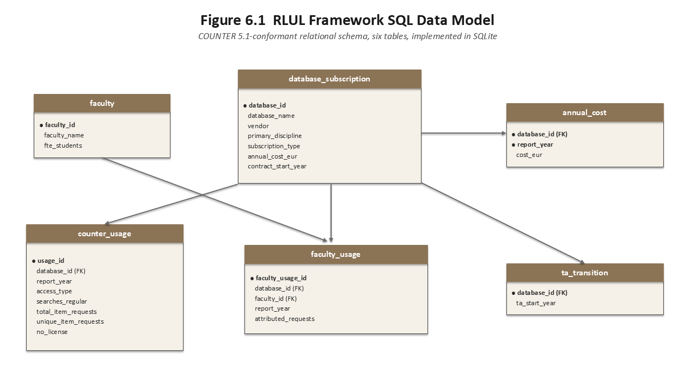

# Library Subscription Evaluation Framework in SQL

A SQLite implementation of a multi-indicator framework for deciding whether an academic library should renew, renegotiate or cancel its database subscriptions. Instead of relying on a single cost-per-use figure, it combines three indicators and turns them into a recommended renewal pathway.

This is a SQL implementation of the framework I designed in my MLIS capstone at University College Dublin (IS41160, 2026), for a fictional mid-sized Irish university library, River Liffey University Library (RLUL). The capstone defined the indicators, the decision pathways and the database; the queries here put them into practice.

**Tech stack:** SQL · SQLite (DB Browser for SQLite) · COUNTER Release 5.1 data structure · Excel

---

## The problem

Libraries usually judge a database by **cost-per-use (CPU)**: annual cost divided by downloads. This has three weaknesses:

1. **Transformative agreements (TAs) blur the numbers.** Under a TA, part of a platform's content is open access, paid for through publishing charges rather than the subscription. Counting those downloads makes the subscription look cheaper than it is.
2. **One number hides context.** A database can look poor value overall but be essential to one faculty.
3. **Renew or cancel is too blunt.** Real options also include moving a resource into a TA or referring it to the national consortium (IReL).

## Data model

Six tables, COUNTER 5.1 aligned, 12 subscription platforms, 2022–2024.

| Table | Rows | Contents |
|---|---|---|
| `database_subscription` | 12 | Platform, vendor, discipline, subscription type |
| `annual_cost` | 36 | Cost per platform per year (composite primary key) |
| `counter_usage` | 40 | COUNTER usage split by access type (Controlled / OA_Gold) |
| `faculty_usage` | 144 | Usage attributed to four faculties |
| `faculty` | 4 | Faculties and FTE students |
| `ta_transition` | 2 | Platforms that moved to a transformative agreement |

## Queries

| File | What it does | SQL used |
|---|---|---|
| [`01_cost_per_use.sql`](queries/01_cost_per_use.sql) | Naive CPU vs subscription-only CPU | Multi-table `JOIN`, `GROUP BY`, conditional aggregation with `CASE WHEN`, `NULLIF` |
| [`02_indicators_and_pathways.sql`](queries/02_indicators_and_pathways.sql) | Three indicator views and the decision layer | `CREATE VIEW`, CTE, window functions (`SUM() OVER`, `RANK()`), `LEFT JOIN`, rule-based `CASE` |
| [`03_cost_yoy.sql`](queries/03_cost_yoy.sql) | Year-over-year cost change | `LAG()` window function, CTE |

The views (`v_cpu`, `v_oa_rate`, `v_concentration`) are saved in `RLUL_demo.db`.

## Results (2024)

| Platform | CPU naive (€) | CPU subscription-only (€) | OA share | Top faculty share | Pathway |
|---|---:|---:|---:|---|---|
| Project MUSE Premium | 8.98 | 8.98 | 0% | Arts & Humanities 77% | **Discipline safeguard: consult faculty** |
| Oxford Handbooks Online | 7.79 | 7.79 | 0% | Science 30% | Cancellation review |
| Nature Journals | 7.62 | 7.62 | 0% | Science 30% | Cancellation review |
| Wiley Online Journals | **5.31** | **7.08** | 25% | Science 30% | **Transformative agreement review** |
| SpringerLINK | 3.72 | 3.72 | 0% | Science 30% | Continue |
| Emerald | 3.18 | 3.18 | 0% | Business 68% | Continue |
| Web of Science | 3.17 | 3.17 | 0% | Science 70% | Continue |
| Scopus | 2.51 | 2.51 | 0% | Science 72% | Continue |
| Cochrane Library | **1.59** | **2.12** | 25% | Health 75% | Continue |
| JSTOR | 2.10 | 2.10 | 0% | Science 30% | Continue |
| ACM Digital Library | 1.99 | 1.99 | 0% | Science 30% | Continue |
| DOAJ | 0.00 | – | 100% | Science 30% | Continue (no-cost OA) |

**What the results show**

- **Separating open access changes the picture.** Wiley's naive CPU of €5.31 sits just above the review line, but its true subscription CPU is €7.08, a third higher. Cochrane rises from €1.59 to €2.12.
- **The safeguard works as intended.** Project MUSE has the highest CPU, but 77% of its use comes from one faculty, so the framework sends it to faculty consultation instead of straight to cancellation.
- **Real cost data shows sharp swings** (`03_cost_yoy.sql`): Nature rose 69.3% in 2023, while Oxford Handbooks fell 41.3% in 2023 and 24.5% in 2024.

Thresholds (CPU review at €5, safeguard at 60% single-faculty share) are illustrative. The capstone leaves final values to a pilot phase.

## Data: what is real and what is modelled

Full details, with every rule as a working formula, are in [`RLUL_data_provenance.xlsx`](RLUL_data_provenance.xlsx). Its Checks sheet confirms that the rules reproduce all 36 cost values, 40 usage rows and 144 faculty rows in the database.

**Real: annual costs.** Taken from the [University of Alberta Library Subscription Expenditures Dataset 2022–2024](https://doi.org/10.7939/DVN/10844) (CC BY 4.0) and converted with a single factor of 0.238:

| Factor | Value | Basis |
|---|---|---|
| Size scaling | 0.35 | Modelled RLUL of 14,000 FTE ÷ an assumed 40,000 FTE for the University of Alberta |
| CAD → EUR | 0.68 | Average of the 2023 and 2024 annual rates: 1 EUR = 1.4597 CAD (2023) and 1.4818 CAD (2024), [Bank of Canada](https://www.bankofcanada.ca/rates/exchange/annual-average-exchange-rates/), i.e. 0.685 and 0.675 EUR per CAD |

Oxford Handbooks Online is the sum of five subject collections. DOAJ is set to €0: the University of Alberta paid a membership fee in 2022, but the model treats DOAJ as a no-cost open access resource.

**Modelled: usage.** No Irish academic library publishes database-level usage reports, so usage was generated from fixed rules that follow the COUNTER 5.1 structure:

- A base download volume per platform and year, with modest growth; Oxford Handbooks declines in line with its falling cost, and Nature is held flat as a control
- Searches = 2 × item requests; unique requests = 80% of item requests (85% for open access); access denials = 1% of searches
- On TA platforms (Wiley and Cochrane from 2023), 25% of use is open access
- Faculty attribution: 30 / 25 / 20 / 25% (rounded FTE shares) for seven platforms, and discipline-specific splits for five
- Rounding: halves round to the nearest even number (796.5 → 796)

The original working file for the modelled usage was not kept. The provenance workbook was rebuilt in October 2026 from these rules and checked against the database.

## Limitations

- **Usage is illustrative**, so the results demonstrate how the framework behaves; they are not findings about any real library.
- **Linear FTE scaling is a simplification.** Vendors usually price by FTE band or institution type. The 40,000 FTE figure is also a rounded assumption: the University of Alberta's [2023–24 annual report](https://www.ualberta.ca/en/media-library/ualberta/reporting/annual-reports-and-financial-statements/uofa-annual-report-2023-24-final.pdf) gives a fall headcount of 44,782. Scaling uses one constant, so a different factor would move every cost by the same percentage: rankings and year-over-year changes stay the same. With a factor based on 44,782, all CPUs fall by about 11% and every pathway stays the same (the lowest CPU above €5, Wiley at €7.08, would become about €6.33).
- **One exchange rate for all three years.** This keeps year-over-year changes in the original CAD prices, without currency movements. The 2022 rate (1.3696 CAD per EUR) was higher, so 2022 costs are about 7% lower than conversion at that year's rate would give.
- **Overlap ratio not implemented.** The capstone's fourth indicator measures how much of a platform is available elsewhere. The dataset holds no overlap data, so it is left for future work.

## How to run

1. Install [DB Browser for SQLite](https://sqlitebrowser.org/) (free).
2. Open `RLUL_demo.db`.
3. In **Execute SQL**, open a file from `queries/` and run it (Ctrl + Enter).

The queries use standard SQL and should run on PostgreSQL with minor changes.

## Author

Ruoxin Liu · MLIS, University College Dublin · [LinkedIn](https://www.linkedin.com/in/ruoxin-liu-4931502a6) · ruoxin.liu.mlis@gmail.com
